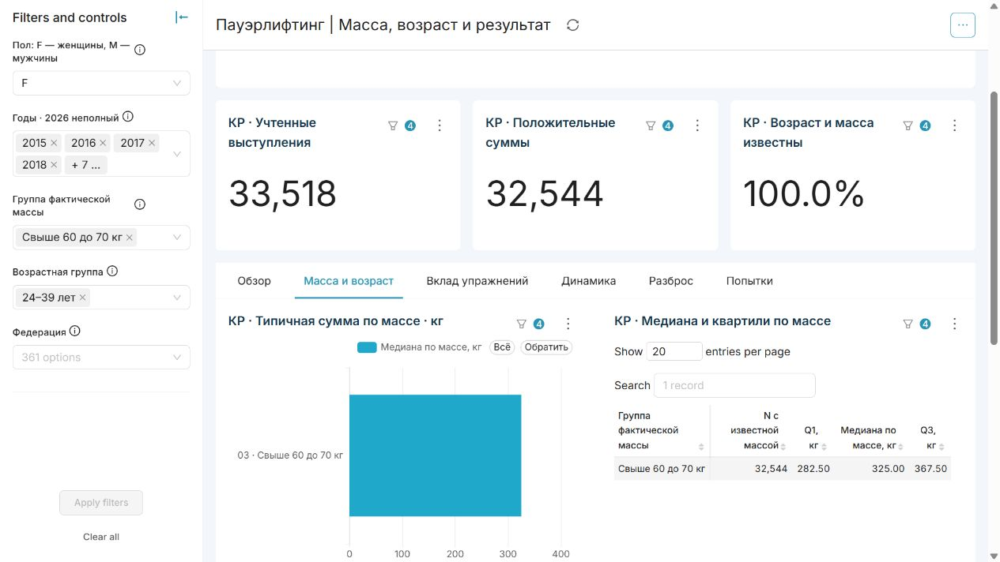
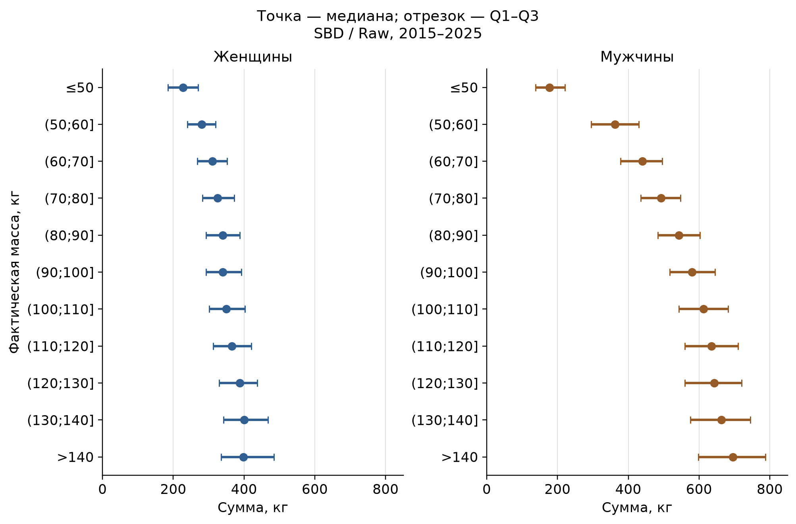

# Анализ результатов соревнований по пауэрлифтингу

Курсовая работа по дисциплине «Технологии хранения больших данных». Тема — сравнительный анализ результатов соревнований в различных весовых и возрастных категориях.

**Автор:** Турлыкин Алексей Дмитриевич, ШАД-211.

[Курсовая — Word](docs/Курсовая_Турлыкин.docx) · [Исходные данные](https://github.com/alekstur/powerlifting-coursework/releases/tag/coursework-v1) · [Результаты расчётов — CSV](reports/results.zip)

## Данные и технологии

Использован полный локальный снимок [OpenPowerlifting](https://www.openpowerlifting.org): **4 043 255 записей**, 42 поля, около 826 МБ. Файл `openpowerlifting-2026-10-03-199bb416.csv` зафиксирован контрольной суммой SHA-256 в [паспорте снимка](reports/snapshot/manifest.json).

Основной анализ охватывает **2015–2025 годы**, троеборье SBD и экипировку Raw. Мужские и женские результаты рассматриваются отдельно. После объединения повторных зачётов за этот период учтено 929 932 выступления; 895 349 имеют пригодную положительную сумму. Неполный 2026 год в основные сравнения не входит.

Python загружает CSV и запускает SQL. PostgreSQL хранит данные, выполняет подготовку и расчёты. Apache Superset показывает графики. Компоненты запускаются через Docker Compose.

## Дашборд и семь задач

Общие фильтры задают пол, годы, фактическую массу, возраст и федерацию. После выбора условий нужно нажать **Apply filters**.

| № | Задача | Вкладка дашборда |
|---|---|---|
| 1 | Определить типичную сумму троеборья по группам массы | «Масса и возраст»: медиана, Q1, Q3 и число результатов |
| 2 | Сравнить возрастные группы внутри одинаковой массы отдельно по полу | «Масса и возраст»: возрастные медианы и численность групп |
| 3 | Определить вклад приседания, жима и тяги в сумму | «Вклад упражнений»: средние индивидуальные доли |
| 4 | Проследить изменение результатов в сопоставимых группах | «Динамика»: годовые медианы при фиксированных поле, массе, возрасте и федерации |
| 5 | Найти наиболее представленные категории и изменение их численности | «Обзор»: число выступлений по массе и годам |
| 6 | Оценить разброс и высокие результаты внутри групп | «Разброс»: межквартильный размах IQR, P90 и максимум |
| 7 | Сравнить успешность попыток в трёх упражнениях | «Попытки»: доля успехов, число попыток и полнота данных |



Пример из курсовой: женщины, масса свыше 60 до 70 кг, возраст 24–39 лет, 2015–2025 годы. Учтено 33 518 выступлений; 32 544 имеют пригодную положительную сумму. Медиана — 325 кг, Q1 — 282,5 кг, Q3 — 367,5 кг.

**Как читать показатели.** N — число выступлений или известных попыток, в зависимости от таблицы. Медиана описывает центральный результат, Q1–Q3 — центральные 50% результатов, P90 — 90-й процентиль. Выступления не равны числу уникальных спортсменов.

Если итоговые результаты указаны без отдельных попыток, график успешности будет пустым. Это отсутствие данных, а не нулевая успешность. Полнота сведений показана в таблице покрытия на вкладке «Попытки».

## Подготовка данных

Исходные строки сохраняются в `staging`; в `core` создаются типизированные записи, выступления и попытки; `mart` содержит таблицы для исследований и дашборда.

- Пустые значения становятся `NULL`, числа и даты преобразуются после проверки формата. Пропуски не заполняются предположениями.
- Повторные зачёты объединяются по совпадающим исходным сведениям, кроме дивизиона и числового места. Связь с исходными строками сохраняется.
- Группы массы заданы постоянными интервалами: до 50 кг, далее шаг 10 кг до 140 кг и группа свыше 140 кг. Это исследовательские интервалы фактической массы.
- Для сравнения сумм нужна пригодная положительная сумма. Для анализа попыток учитываются известные исходы: положительный вес — успех, отрицательный — неудача. Пустые поля и нули с неизвестным исходом в знаменатель успешности не входят.

Подготовка и SQL-проверки выполняются в одной транзакции: при ошибке изменения отменяются. Повторная загрузка того же CSV не добавляет записи второй раз.

## Результаты



В наиболее многочисленных группах положительных результатов медиана суммы составила **310 кг у женщин с массой (60; 70] кг** и **542,5 кг у мужчин с массой (80; 90] кг**. Внутри этих интервалов наибольшие возрастные медианы относятся к группе 24–39 лет: 325 и 570 кг соответственно.

В общей выборке пригодных результатов на тягу приходится наибольшая средняя индивидуальная доля суммы: 43,79% у женщин и 41,14% у мужчин. Среди известных попыток самая низкая успешность у жима: 72,87% и 73,68% соответственно.

Подробные результаты семи исследований приведены в Word и архиве CSV. При проверке повторного запуска все 14 CSV совпали с сохранёнными результатами. Выводы относятся к опубликованным выступлениям; пропуски и различия состава участников ограничивают сравнения.

## Состав репозитория

| Путь | Содержимое |
|---|---|
| `docs/` | Курсовая Word и две иллюстрации для README |
| [src/main.py](src/main.py) | Загрузка CSV, подготовка таблиц и выполнение исследований |
| [src/setup.py](src/setup.py) | Создание недостающих локальных паролей и ключей |
| `sql/` | Исходные таблицы, очистка, проверки и исследовательские запросы |
| `superset/` | Экспорт дашборда, настройки и импорт |
| `reports/` | Паспорт снимка и проверенные результаты в `results.zip` |
| `openpowerlifting-2026-10-03/` | Оригинальные описание и лицензия; CSV скачивается из Releases |
| `compose.yaml`, `Dockerfile`, `requirements.txt` | Конфигурация контейнеров и зависимостей |
| [TZ.md](TZ.md) | Семь исследовательских задач |

## Установка и запуск

Нужны Docker Desktop с Linux-контейнерами и Python. Скачайте архив данных из Releases и распакуйте так, чтобы CSV находился в папке `openpowerlifting-2026-10-03`.

Скопируйте `.env.example` в `.env` и замените `POSTGRES_PASSWORD` на свой локальный пароль. Выполните из корня проекта:

```powershell
python src/setup.py
docker compose build app superset
docker compose up -d --wait postgres
docker compose run --rm app python src/main.py load
docker compose run --rm app python src/main.py prepare
docker compose run --rm app python src/main.py superset-db
docker compose run --rm superset superset db upgrade
docker compose run --rm superset superset init
docker compose run --rm superset python /app/coursework/setup.py
docker compose up -d --wait superset
```

После установки: [открыть локальный дашборд](http://localhost:8088/superset/dashboard/powerlifting-coursework/). Для ознакомления без запуска доступны иллюстрации выше, Word и CSV.

Обычный запуск уже подготовленного проекта:

```powershell
docker compose up -d --wait postgres superset
```

Повторный расчёт исследований:

```powershell
docker compose run --rm app python src/main.py research
```

Новые CSV сохраняются в `reports/research` в отдельную папку запуска. Остановка с сохранением базы: `docker compose stop`. Для редактирования дашборда используется пользователь `coursework`; пароль — значение `SUPERSET_ADMIN_PASSWORD` в локальном `.env`. Пароли в репозиторий не входят.
